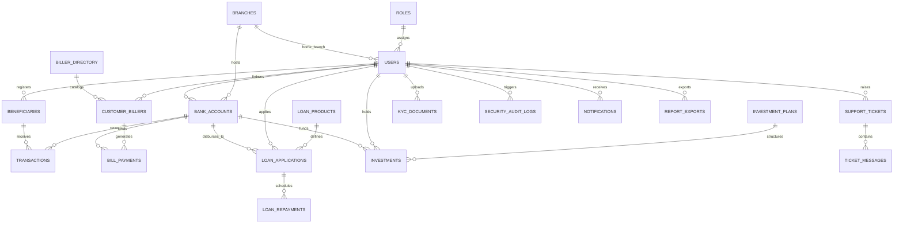

# BankEase (P18) — 3NF Database Schema & Entity-Relationship Documentation

This document details the **3rd Normal Form (3NF)** MySQL 8.0 relational database schema (`bankease_db`), table structures, constraints, edge-case test records, and Entity-Relationship (ER) mappings across all 10 modules of **BankEase - NextGen Net Banking Application**.

---

## 1. 3NF Normalization Design Principles
1. **First Normal Form (1NF):** Every table has a surrogate/natural Primary Key (`AUTO_INCREMENT`), atomic columns, and no repeating groups or comma-separated lists.
2. **Second Normal Form (2NF):** All non-key attributes are fully functionally dependent on the entire primary key. Composite uniqueness constraints (such as `(user_id, biller_id, consumer_number)` in `customer_billers` or `(loan_id, installment_number)` in `loan_repayments`) prevent duplicate associations while keeping reference attributes in their respective master tables.
3. **Third Normal Form (3NF):** Transitive dependencies are eliminated:
   - Role names and descriptions are separated into `roles` (`users.role_id -> roles.role_id`).
   - Branch IFSC, city, and address details are stored in `branches` (`bank_accounts.branch_id -> branches.branch_id`) rather than duplicated per account.
   - Biller metadata is stored in `biller_directory`, Loan product parameters in `loan_products`, and Investment scheme rates in `investment_plans`.

---

## 2. Complete Table Summary (20 Tables Across 10 Modules)

| # | Module | Table Name | Type | Primary Key | Foreign Keys | Seed Rows |
| :--- | :--- | :--- | :--- | :--- | :--- | :--- |
| 1 | Module 1: User Auth | `roles` | Master | `role_id` | — | 4 |
| 2 | Module 1 & 2 | `branches` | Master | `branch_id` | — | 12 |
| 3 | Module 1: User Auth | `users` | Master | `user_id` | `role_id`, `home_branch_id` | 15 |
| 4 | Module 2: Account Mgmt | `bank_accounts` | Master | `account_id` | `user_id`, `branch_id` | 15 |
| 5 | Module 3: Funds Transfer | `beneficiaries` | Master | `beneficiary_id` | `user_id` | 14 |
| 6 | Module 3: Funds Transfer | `transactions` | Transaction | `transaction_id` | `account_id`, `counterparty_account_id`, `beneficiary_id` | 75 |
| 7 | Module 4: Bill Payment | `biller_directory` | Master | `biller_id` | — | 12 |
| 8 | Module 4: Bill Payment | `customer_billers` | Associative | `customer_biller_id` | `user_id`, `biller_id`, `preferred_account_id` | 14 |
| 9 | Module 4: Bill Payment | `bill_payments` | Transaction | `bill_payment_id` | `customer_biller_id`, `account_id`, `transaction_id` | 55 |
| 10 | Module 5: Loan Mgmt | `loan_products` | Master | `loan_product_id` | — | 10 |
| 11 | Module 5: Loan Mgmt | `loan_applications` | Entity | `loan_id` | `user_id`, `disbursement_account_id`, `loan_product_id`, `reviewed_by_officer_id` | 12 |
| 12 | Module 5: Loan Mgmt | `loan_repayments` | Transaction | `repayment_id` | `loan_id`, `transaction_id` | 60 |
| 13 | Module 6: Investments | `investment_plans` | Master | `plan_id` | — | 10 |
| 14 | Module 6: Investments | `investments` | Entity | `investment_id` | `user_id`, `funding_account_id`, `plan_id` | 14 |
| 15 | Module 7: Customer Support | `support_tickets` | Entity | `ticket_id` | `user_id`, `assigned_officer_id`, `related_transaction_id` | 14 |
| 16 | Module 7: Customer Support | `ticket_messages` | Transaction | `message_id` | `ticket_id`, `sender_user_id` | 28 |
| 17 | Module 8: Security & KYC | `kyc_documents` | Entity | `kyc_doc_id` | `user_id`, `verified_by_officer_id` | 15 |
| 18 | Module 8: Security & Audit | `security_audit_logs` | Transaction | `audit_id` | `user_id` | 60 |
| 19 | Module 9: Notifications | `notifications` | Transaction | `notification_id` | `user_id` | 60 |
| 20 | Module 10: Reporting | `report_exports` | Entity | `report_id` | `generated_by_user_id` | 12 |

---

## 3. Entity-Relationship (ER) Cardinality Summary

### One-to-Many (`1 : N`) Relationships
1. **`roles` (1) $\rightarrow$ `users` (N):** One role (`ADMIN`, `BANK_OFFICER`, `CUSTOMER`, `AUDITOR`) is assigned to many users (`users.role_id`).
2. **`branches` (1) $\rightarrow$ `users` (N):** One bank branch serves as the home branch for many users (`users.home_branch_id`).
3. **`branches` (1) $\rightarrow$ `bank_accounts` (N):** One branch holds many customer bank accounts (`bank_accounts.branch_id`).
4. **`users` (1) $\rightarrow$ `bank_accounts` (N):** One customer can hold multiple accounts (e.g., Savings, Current, Salary) (`bank_accounts.user_id`).
5. **`users` (1) $\rightarrow$ `beneficiaries` (N):** One customer can register multiple transfer payees/beneficiaries (`beneficiaries.user_id`).
6. **`bank_accounts` (1) $\rightarrow$ `transactions` (N):** One bank account records many debit and credit ledger transactions (`transactions.account_id`).
7. **`beneficiaries` (1) $\rightarrow$ `transactions` (N):** One registered beneficiary can receive multiple outward transfers (`transactions.beneficiary_id`).
8. **`customer_billers` (1) $\rightarrow$ `bill_payments` (N):** One linked consumer biller registration generates many monthly bill payment records (`bill_payments.customer_biller_id`).
9. **`loan_products` (1) $\rightarrow$ `loan_applications` (N):** One loan product template is used across many customer loan applications (`loan_applications.loan_product_id`).
10. **`loan_applications` (1) $\rightarrow$ `loan_repayments` (N):** One sanctioned loan application has many monthly EMI amortization schedule rows (`loan_repayments.loan_id`).
11. **`support_tickets` (1) $\rightarrow$ `ticket_messages` (N):** One support ticket contains a thread of many customer and officer messages (`ticket_messages.ticket_id`).
12. **`users` (1) $\rightarrow$ `kyc_documents` (N):** One user uploads multiple KYC identity/address proof documents (`kyc_documents.user_id`).
13. **`users` (1) $\rightarrow$ `security_audit_logs` (N):** One user generates many immutable security and compliance audit trail entries (`security_audit_logs.user_id`).
14. **`users` (1) $\rightarrow$ `notifications` (N):** One user receives many real-time alerts and notifications (`notifications.user_id`).
15. **`users` (1) $\rightarrow$ `report_exports` (N):** One user (Customer, Officer, or Admin) generates many downloadable financial/compliance reports (`report_exports.generated_by_user_id`).

### Many-to-Many (`M : N`) Relationships (Resolved via Associative Tables)
1. **`users` (M) $\leftrightarrow$ `biller_directory` (N) via `customer_billers`:**
   - A customer can link multiple utility billers, and a utility biller (e.g., UPPCL, JioFiber, BESCOM) is linked by many customers.
2. **`users` (M) $\leftrightarrow$ `investment_plans` (N) via `investments`:**
   - A customer can subscribe to multiple FD/RD/Mutual Fund plans, and each investment plan has many customer subscriptions.
3. **`users` (M) $\leftrightarrow$ `loan_products` (N) via `loan_applications`:**
   - A customer can apply for multiple loan products over time, and each loan product is applied for by many customers (with Bank Officer review also linked via `reviewed_by_officer_id`).

---

## 4. Mermaid ER Diagram (Can also be imported into draw.io)

---

## 5. Validation & Edge-Case Test Records Included (`seed_data.sql`)

To satisfy **Table 3 Requirement #5** of the project specification, `seed_data.sql` includes 5 dedicated validation edge-case user profiles (`user_id` 11 through 15) and associated records:

1. **Edge Case 1 (`user_id = 11`, `edge_null_optional`):**
   - **Scenario:** Empty optional fields (`NULL` values for `home_branch_id`, `date_of_birth`, `pan_number`, `aadhaar_last4`, `address_line`, `city`, `state`, `pincode`, and `last_login_at`), paired with a zero-balance `PENDING_KYC` account (`account_id = 11`).
2. **Edge Case 2 (`user_id = 12`, `edge_maxlen_text`):**
   - **Scenario:** Maximum-length text boundary testing — exact 120-character `full_name` and exact 255-character `address_line` to verify UI wrapping, PDF statement rendering (`TKT20250008`), and VARCHAR boundary handling.
3. **Edge Case 3 (`user_id = 13`, `rohit_sharma_del`):**
   - **Scenario:** Duplicate-looking name #1 (`"Rohit Kumar Sharma"`, Lajpat Nagar IV, New Delhi, DOB `1994-11-05`) with an unverified beneficiary in `COOLING` status (`beneficiary_id = 13`).
4. **Edge Case 4 (`user_id = 14`, `rohit_sharma_ncr`):**
   - **Scenario:** Duplicate-looking name #2 (`"Rohit Kumar  Sharma"` with double internal space, same locality and DOB, but distinct `pan_number`, `phone_number`, and `email`) to test search deduplication and officer verification workflows.
5. **Edge Case 5 (`user_id = 15`, `edge_locked_user`):**
   - **Scenario:** Locked security profile (`is_active = FALSE`, `is_locked = TRUE`, `failed_login_attempts = 5`, `kyc_status = 'REJECTED'`), a `FROZEN` bank account (`account_id = 15`), a `BLOCKED` beneficiary (`beneficiary_id = 14`), and a `FLAGGED` high-risk IMPS transaction (`transaction_id = 20`).
